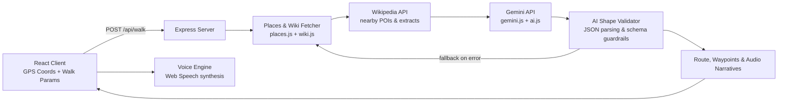

<div align="center">


Every city has layers of forgotten history, hidden architecture, and untold stories right beneath your feet[cite: 1]. Invisible City turns everyday walks into narrated, sensory explorations using live coordinates, Wikipedia knowledge, and Gemini AI[cite: 1].

<p align="center">
  
  
  
  
  
  
</p>

[**Live demo**](#) · [**Report an issue**](../../issues)

</div>

---

## Motivation

City walking apps and tourist maps steer everyone toward the same overcrowded landmarks, commercial districts, and gift shops. Meanwhile, the most fascinating parts of an urban landscape—forgotten brickworks, hidden alleyway murals, lost canals, historic plaques, and century-old events—are passed by unnoticed every day[cite: 1].

Invisible City was built to act as a knowledgeable, local historian walking right beside you[cite: 1]. By anchoring live location data to open Wikipedia archives and synthesizing human-scale stories via Gemini, it turns an ordinary walk into a self-paced, eyes-up discovery session[cite: 1].

## Features

| Feature | Description |
|---|---|
| **Hyper-local discovery** | Detects coordinates, queries surrounding heritage sites, and surfaces nearby points of interest using open geo and Wikipedia APIs[cite: 1]. |
| **Narrative walk generation** | Assembles cohesive, themed walking paths (architecture, social history, forgotten infrastructure) based on user location and walk radius[cite: 1]. |
| **Grounded AI storytelling** | Prompts Google Gemini with factual Wikipedia extracts to generate vivid, bite-sized historical narratives without generic fluff[cite: 1]. |
| **Eyes-up voice narration** | Integrated Web Speech API audio playback reads historical stories as you move, keeping your eyes on the street rather than glued to a screen[cite: 1]. |
| **Strict schema guardrails** | Validates and sanitizes AI responses on the client and server (`aiShape.js`) to guarantee clean JSON structures, fallback handling, and graceful recovery[cite: 1]. |
| **Zero coordinate persistence** | Location coordinates are queried in memory for discovery and route planning—never saved or tracked across sessions[cite: 1]. |

## Architecture



1. **Location resolution.** Coordinates received from the browser are passed to the server layer to discover nearby points of interest and heritage structures.


2. **Fact retrieval.** Relevant Wikipedia extracts and place descriptions are queried directly to provide verifiable factual context for the walk.


3. **Contextual synthesis.** Gemini receives the retrieved factual data and crafts thematic stops with conversational narratives suitable for walking listening times.


4. **Resilience & formatting.** Responses pass through shape and schema verification (`server/ai.js` and `src/lib/aiShape.js`) to guarantee valid stop payloads, fallback to raw summaries if generation stumbles, and drive speech synthesis reliably.


## Tech stack

| Layer | Choice |
| --- | --- |
| Frontend | React + Vite|
| Styling | Modern responsive CSS|
| Audio & Voice | Web Speech API (`SpeechSynthesis`)|
| Backend | Node.js + Express|
| AI | Google Gemini API|
| Knowledge Base | Wikipedia API / Wikimedia geo endpoints|
| Testing | Node test runner / unit tests for Wiki, Gemini, Places, and Walk logic|

## Getting started

**Requirements:** Node.js 18+ and a [Google AI Studio Gemini API Key](https://aistudio.google.com/).

```bash
git clone [https://github.com/](https://github.com/)<your-username>/InvisibleCity.git
cd InvisibleCity

# 1. Install dependencies
npm install

# 2. Configure environment variables
cp .env.example .env

```

Add your Gemini API credentials to `.env`:

```env
PORT=3000
GEMINI_API_KEY=your_gemini_api_key_here

```

### Running locally

```bash
# Start backend server
npm run server

# In another terminal, start the Vite frontend
npm run dev

```

Open `http://localhost:5173` in your browser. Ensure browser location permissions are allowed so coordinates can be read.

### Environment variables (`.env`)

| Variable | Required | Description |
| --- | --- | --- |
| `GEMINI_API_KEY` | Yes | API key from Google AI Studio |
| `PORT` | No | Express server port (default `3000`) |

## Testing

The project includes test coverage across all critical utilities:

```bash
npm test

```

Test suites verify:

* `server/gemini.test.js` – Prompt synthesis and model interaction


* `server/places.test.js` – Coordinate-to-place logic and distance calculations


* `server/wiki.test.js` – Geosearch queries and article snippet parsing


* `src/lib/walk.test.js` – Route step ordering and waypoint progression


## Project structure

```
InvisibleCity/
├── server/
│   ├── index.js          # Express entry point & HTTP endpoints[cite: 1]
│   ├── gemini.js         # Google Gemini SDK setup & prompt orchestration[cite: 1]
│   ├── places.js         # Geographic query handling & coordinate utilities[cite: 1]
│   ├── wiki.js           # Wikipedia geosearch & extract client[cite: 1]
│   └── ai.js             # Narrative formatting & verification logic[cite: 1]
├── src/
│   ├── App.jsx           # Main interactive map view, state, and UI controls[cite: 1]
│   ├── main.jsx          # React DOM entry point[cite: 1]
│   ├── styles.css        # App styling and interface tokens[cite: 1]
│   └── lib/
│       ├── ai.js         # Client-side AI request handler[cite: 1]
│       ├── aiShape.js    # Payload verification & defensive structure checks[cite: 1]
│       ├── voice.js      # Speech synthesis & text-to-speech audio controller[cite: 1]
│       └── walk.js       # Waypoint sequencing and walking progress tracker[cite: 1]
├── package.json
└── vite.config.js

```

## Limitations

* **Source availability:** Suburban and rural areas may have fewer geolocated Wikipedia articles, resulting in shorter or sparser walk suggestions.


* **Generative embellishment:** While stories are anchored to factual Wikipedia summaries, generative LLMs can occasionally fill narrative pauses with creative framing. Always verify specific dates and claims if using for academic research.


* **Browser TTS variation:** Web Speech API voice timbre and naturalness depend entirely on the operating system and browser installed voices.


* **Rate limits:** Generating continuous new walks in quick succession uses standard Gemini free-tier quota limits.

## Contributing

Contributions, bug fixes, and suggestions are welcome!

1. Fork the repository
2. Create a feature branch (`git checkout -b feature/NewFeature`)
3. Commit your changes (`git commit -m 'Add NewFeature'`)
4. Push to the branch (`git push origin feature/NewFeature`)
5. Open a Pull Request

## License

[MIT](https://www.google.com/search?q=LICENSE)